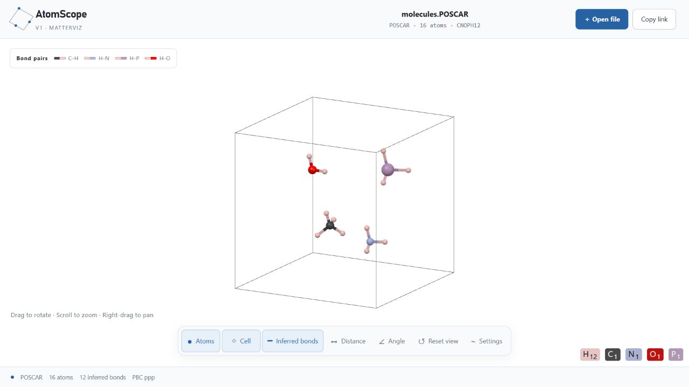
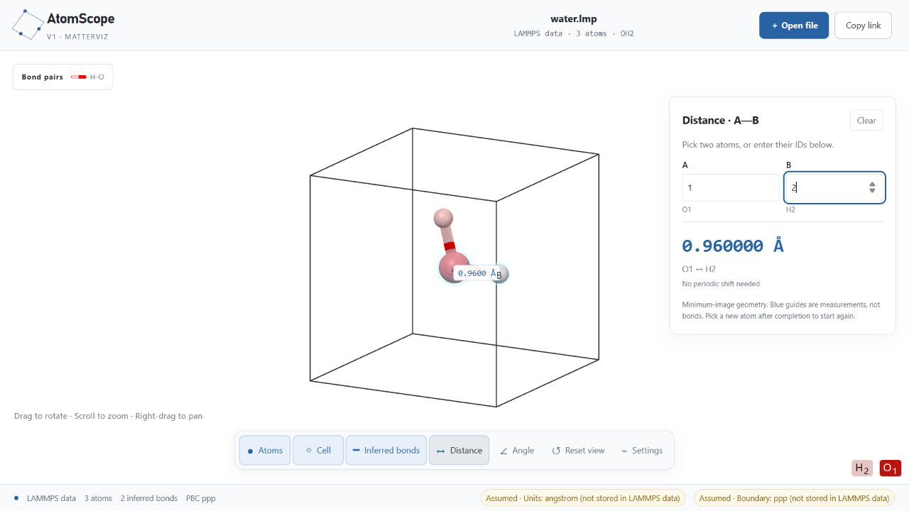
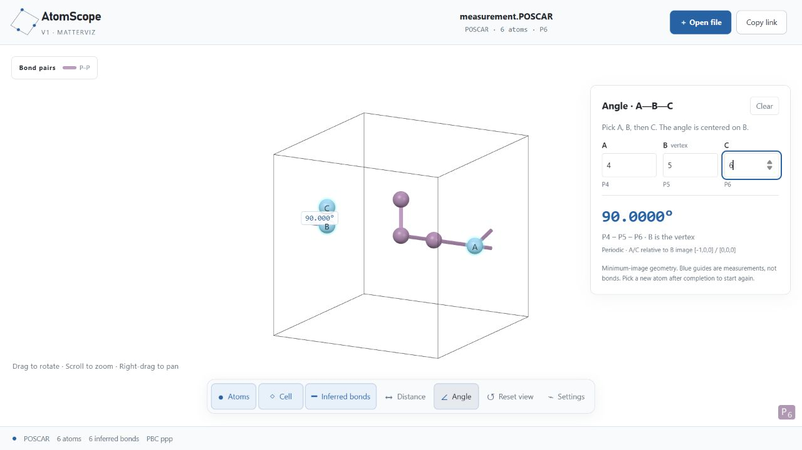

# AtomScope

**Open a structure. Explore the cell. Measure what matters.**

A local-first, interactive viewer for **VASP POSCAR/CONTCAR** and **LAMMPS atomic data**. Inspect atoms, inferred bonds and periodic cells in your browser, with distance and angle measurements built in.

No account, database, Codex or ChatGPT installation is required. This repository runs a webpage on **your own computer**; it is not a hosted online service.



*Actual application screenshot using the included [16-atom demonstration structure](examples/structures/molecules.POSCAR). All README images use synthetic examples, not private research data.*

[Quick start](#quick-start) · [Examples](#try-the-examples) · [Measurements](#measure-distances-and-angles) · [Formats](#supported-formats) · [Privacy](#privacy-and-local-links) · [Troubleshooting](#troubleshooting)

## What you can do

- **Explore in 3D:** drag to rotate, scroll to zoom, and right-drag to pan.
- **Control the display:** toggle atoms, cell edges and inferred bonds; adjust atom size and bond radius independently.
- **Read periodic structures:** wrapped atoms and boundary-crossing bond segments keep the primary cell readable.
- **Measure geometry:** choose two atoms for a distance, or three for an angle, using periodic minimum images.
- **Inspect bond inference:** adjust the covalent-radius multiplier or set element-pair distance overrides.
- **Reopen by link:** copy a self-contained structure URL without uploading a file.

The white-background, ball-and-stick appearance is fixed by a tested style preset. Display sizes and lighting do not change coordinates or bond-detection rules.

## Quick start

### 1. Get the source and prerequisites

Install **[Node.js](https://nodejs.org/) 22.13 or newer**, including npm. Download and extract the source ZIP, or clone the repository. Open a terminal **inside the project folder**, where `package.json` is located.

The source package must be built before use; double-clicking a file in the folder does not start the viewer. A browser with hardware-accelerated 3D graphics is required. Local validation has been performed on Windows; other operating systems have not been verified in this release.

### 2. Install, build and launch

```sh
npm ci
npm run build
npm run local:viewer
```

The first command downloads dependencies; the second creates the application and renderer bundles. The launcher starts a background service bound to loopback only.

### 3. Open your first structure

Open **[http://127.0.0.1:43117/](http://127.0.0.1:43117/)**. Click **Open file** or drag a supported file onto the page.

For a first look, choose `examples/structures/molecules.POSCAR`. After restarting your computer, run `npm run local:viewer` again. You do not need to reinstall or rebuild unless the source or dependencies change.

## Try the examples

| Example | What to try | Expected result |
| --- | --- | --- |
| [Molecular motifs](examples/structures/molecules.POSCAR) | Rotate the cell and inspect the five element colors | 16 atoms, 12 inferred bonds at default settings |
| [Water, LAMMPS data](tests/fixtures/water.lmp) | Measure atoms **1 → 2** | **0.960000 Å** |
| [Periodic measurement cell](tests/fixtures/measurement.POSCAR) | Measure **4 → 5**, then angle **4 → 5 → 6** | **1.000000 Å**, **90.0000°**, with periodic image shifts |
| [Water, POSCAR](tests/fixtures/water.POSCAR) | Open the same water geometry in the other format | 3 atoms, 2 inferred bonds |

These are interface examples, not optimized structures or validated simulation inputs. See [example provenance](examples/structures/README.md).

## Find your way around

| Control | Action |
| --- | --- |
| **Open file** | Load a supported structure |
| **Copy link** | Encode the structure and bond rules into a URL |
| **Atoms / Cell / Inferred bonds** | Show or hide each layer |
| **Distance / Angle** | Open a measurement mode |
| **Reset view** | Restore the camera; it does not reset bond settings |
| **Settings → Display size** | Adjust atom size and bond radius |
| **Settings → Bond inference** | Adjust the radius multiplier and inspect bond counts |
| **Settings → Pair overrides** | Add, disable or remove a pair-specific distance range |

**Mouse controls:** left-drag to rotate, scroll to zoom, right-drag to pan. Click an atom without dragging to select it. Measurements do not require the atoms to be bonded.

## Measure distances and angles

### Distance: choose A and B

1. Click **Distance**.
2. Click two atoms, or enter their viewer IDs in **A** and **B**.
3. Read the distance in angstroms. If the shortest connection crosses a boundary, the panel also shows the periodic image shift.



*The water fixture gives O1–H2 = 0.960000 Å. Blue highlights and guides are measurements, not inferred bonds.*

### Angle: choose A, then B, then C

1. Click **Angle** and select three atoms, or enter their IDs.
2. **B is the vertex:** the reported angle is A–B–C.
3. The two vectors use the nearest periodic images of **B → A** and **B → C**.



*In this fixture, A is across the boundary from B. The angle remains 90.0000° rather than being computed from a long line through the box.*

Viewer IDs start at **1** and refer to the parsed atom list; they may differ from arbitrary atom IDs in a LAMMPS source file. Click **Clear** to start over. Clicking a selected atom deselects it; picking a new atom after a completed measurement starts a new selection. Repeating the same atom is rejected.

Distances and angles are shown to six and four decimal places respectively. Display precision is not a claim about physical accuracy. Selections and display-size adjustments are session-local and are not saved in copied links.

## Supported formats

| Format | Common filenames | Supported |
| --- | --- | --- |
| VASP structure | `POSCAR`, `CONTCAR`, `.vasp`, `.poscar`, `.contcar` | VASP 5/6 element row; one positive scale; Direct or Cartesian; Selective dynamics; nonsingular cells |
| LAMMPS text data | `.lmp`, `.data`, `.lammps` | Explicit `Atoms # atomic`; orthogonal or restricted triclinic boxes; optional image flags |

**Not supported:** CIF, XYZ, PDB, VASP4 without an element row, negative or three-component POSCAR scale, LAMMPS dump/restart, general triclinic data, or `full`, `charge` and `molecular` atom styles. This is a single-structure viewer, not a trajectory player or structure editor.

LAMMPS data does not record units or boundary conditions. The viewer assumes **angstroms** and **ppp** and labels those assumptions. Confirm they match your simulation; other unit systems are not converted automatically.

Element mappings are read from `Masses` line-end comments:

```text
Masses

1 15.999 # O
2 1.008  # H
```

Without a complete mapping, atoms remain visible as types, but inferred bonds are disabled. Supply a verified mapping through the command-line link generator if needed.

## Privacy and local links

**Structures stay on your computer during normal local viewing.** The browser reads the file; the application has no structure-upload API or database. Dependency installation needs network access, but the installed viewer does not need a hosted account.

**A copied link is data, not encryption.** Its fragment contains the normalized structure, supplied filename, metadata and bond settings. Normal file/CLI loading does not include original comments or absolute source paths, but a sensitive filename can still identify a project. Anyone with the full URL can decode it.

`127.0.0.1` refers to the computer opening the link. A colleague must first run their own compatible viewer at the same port; your local link does not give them remote access to your computer. Publishing this repository on GitHub does **not** automatically publish an online viewer.

### Generate a link from the terminal

After building:

```sh
npm run make-view-link -- examples/structures/molecules.POSCAR
npm run make-view-link -- tests/fixtures/water.lmp --type-map 1:O,2:H --pbc ppp
```

The command starts the local viewer if needed and prints its URL. Quote paths containing spaces. Windows also supports `make-view-link.cmd`. Boundary flags use three `p`/`f` characters, such as `ppp` or `ppf`.

URLs longer than **100,000 characters** are rejected. For larger structures, open the file directly instead. See [privacy notes](docs/PRIVACY.md) for the source-distribution policy.

## What an inferred bond means

The default rule uses [Blue Obelisk BODR](https://github.com/BlueObelisk/bodr) covalent radii and periodic minimum-image distances:

```text
0.40 Å ≤ distance < 1.15 × (radius_A + radius_B)
```

The upper cutoff is strict: a distance exactly equal to it is excluded. Pair overrides can supply their own minimum/maximum range. Atom-size and bond-radius sliders only change appearance.

These lines are geometric hints, **not chemical bond orders**, a reaction detector or evidence that a structure is physically valid. No VESTA program files or bond tables are bundled.

## Troubleshooting

| Problem | What to check |
| --- | --- |
| `npm` is not found | Install Node.js with npm, then reopen the terminal |
| Local viewer build is missing | Run `npm ci` and `npm run build` from the project folder |
| The page cannot be reached | Run `npm run local:viewer` again; use the exact URL it prints |
| Port 43117 is occupied | Choose another port; do not stop an unrelated service |
| The page loads but the 3D view is blank | Check browser hardware acceleration and graphics support; a blank view does not prove missing atoms |
| Atoms appear but bonds do not | Enable **Inferred bonds**, check the element mapping and inspect distance thresholds |
| A file is rejected | Check the supported subset and reported line number; renaming a file does not convert it |
| A link fails on another computer | Start the viewer there first at the same port; use the complete, untruncated link |

To choose another port in **PowerShell**:

```powershell
$env:ATOM_VIEWER_PORT = "43118"
npm run local:viewer
```

Or in a **POSIX shell**:

```sh
ATOM_VIEWER_PORT=43118 npm run local:viewer
```

Run the link generator with the same environment setting to create links for that port. The launcher runs the service in the background; closing the browser tab does not stop it.

## Development and checks

Use `npm run dev` for development. For regression checks:

```sh
npm test
npx tsc --noEmit
npx eslint app lib/ui-text.ts
npm run build
```

Tests cover parsing, sharing, periodic geometry, measurements and the fixed appearance. See [VALIDATION.md](docs/VALIDATION.md) for bounded local results, not a guarantee for every browser or GPU.

MatterViz **0.4.4** is compiled through guarded local adapters. The independent appearance baseline is [`approved-viewer-style.json`](web-components/approved-viewer-style.json). Generated bundles and dependencies are excluded from the source ZIP and recreated during installation/build.

To compare your own paired POSCAR / `conf.lmp` files:

```sh
npm run audit:local -- ./my-paired-data
```

In a Git checkout with tracked files, `npm run check:privacy` scans common private-path, credential and deployment markers. It does not replace a manual review or inspect ignored files and the entire Git history.

## Credits and release status

Built with [MatterViz](https://github.com/janosh/matterviz), React, Svelte and Three.js, with covalent radii from BODR. See [THIRD_PARTY_NOTICES.md](THIRD_PARTY_NOTICES.md) for attribution.

**No application license has been selected yet.** Dependency licenses do not automatically license this application's original code. See the [publishing checklist](docs/PUBLISHING.md) before a public release. Public hosting is optional and is not configured by this source package.
