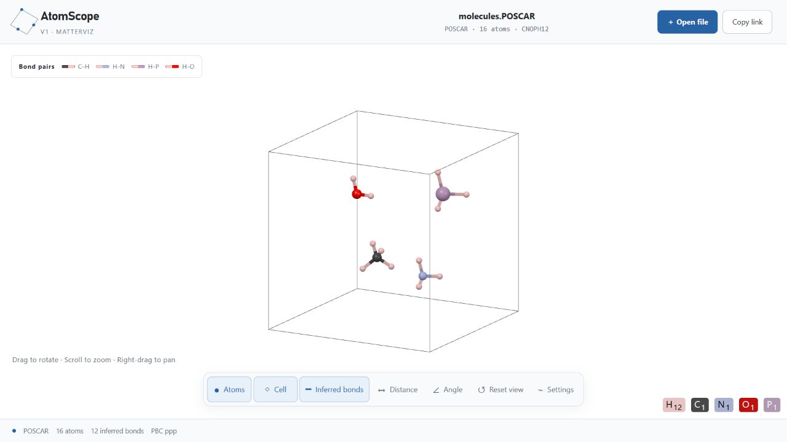
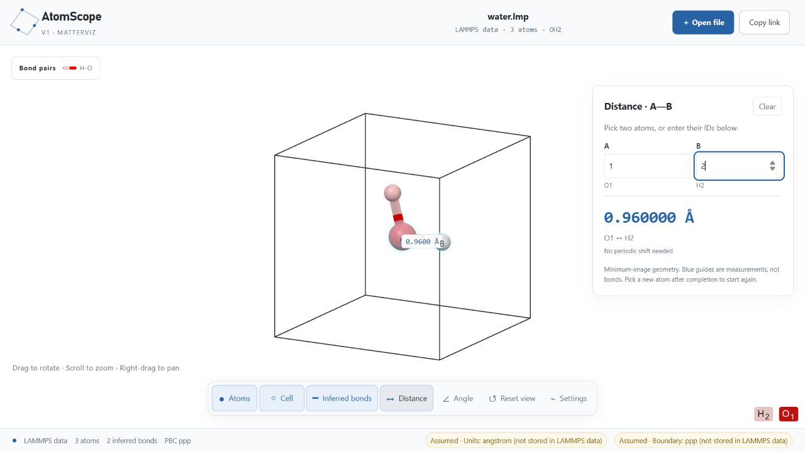
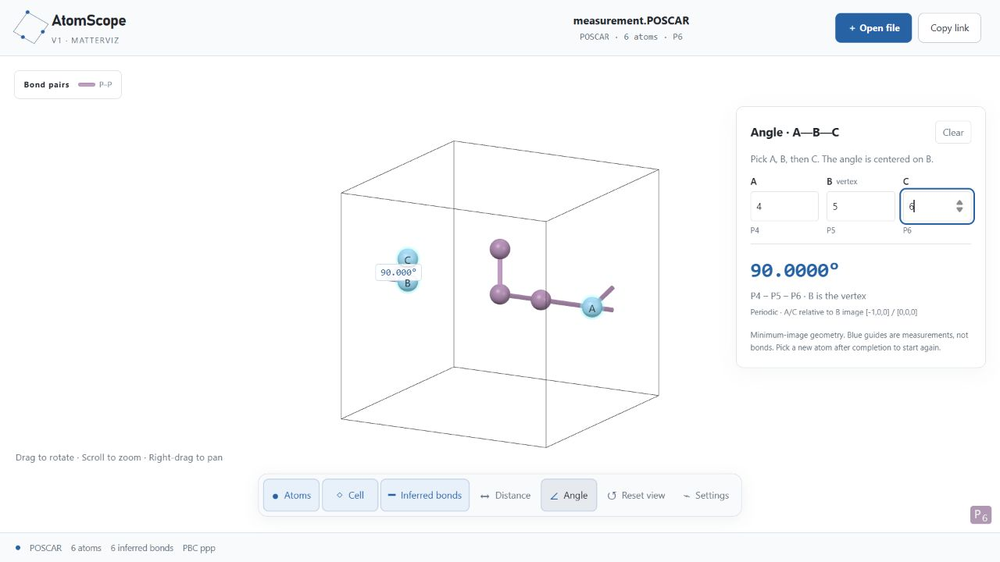

# AtomScope

**面向 Agent 工作流的本地优先原子结构查看器。**

一个优先在本地运行的交互式原子结构查看器，支持 **VASP POSCAR/CONTCAR** 和 **LAMMPS atomic data** 文件。在浏览器中查看原子、推断键与周期晶胞，并测量原子间距离和夹角。

无需注册账号，无需数据库，也无需安装 Codex 或 ChatGPT。本项目在**你自己的电脑上**运行网页，不是托管好的在线服务。



*上图为应用实际截图，使用项目内附的 [16 原子演示结构](examples/structures/molecules.POSCAR)。本说明中的全部截图均来自人工构造的示例，不包含私人科研数据。*

[English](README.md) · [快速开始](#快速开始) · [配合-agent-skill-使用](#配合-agent-skill-使用) · [试用示例](#试用示例) · [距离与角度测量](#距离与角度测量) · [支持的文件格式](#支持的文件格式) · [隐私与本地链接](#隐私与本地链接) · [常见问题](#常见问题)

## 为什么适合 Agent 工作流

将本地结构文件变成可点击、可交互的浏览器视图：

```text
你提出查看需求 → Agent 定位文件 → 本地命令生成链接 → 你点击检查结构
```

- **命令行直接调用：**Agent 不必模拟桌面软件的鼠标操作，就能完成从文件到可视化入口的交付。
- **方便人工检查：**你可以旋转结构、查看周期边界、测距和测角，再决定下一步操作。
- **本地优先：**不需要公网托管或结构上传服务；Agent 与查看器需要能访问同一个本地环境。
- **轻量浏览器界面：**可在普通浏览器中查看，也可在支持本地网页的 Agent 应用侧边浏览器中打开。
- **可复用的操作流程：**可选 Skill 统一文件选择、元数据处理和出错检查，减少每次重复说明。

AtomScope 专注于结构检查，不替代 VESTA、OVITO 的全部专业功能。显示成功不等于科学正确，推断键也不代表化学键级。**配合 Agent 时还需考虑 Agent 自身的数据处理策略：本地渲染不保证 Agent 不会把文件内容或链接发送给模型服务商。**

## 可以做什么

- **交互查看三维结构：**拖拽旋转、滚轮缩放、右键拖拽平移。
- **调整显示：**独立开关原子、晶胞边框和推断键，分别调节原子大小与键半径。
- **查看周期结构：**将原子折回主晶胞，在周期边界两侧显示跨界键的对应线段。
- **测量几何关系：**选择两个原子测距离，选择三个原子测夹角，采用周期最小镜像计算。
- **调整推断键规则：**修改共价半径倍率，或为指定元素对设置距离范围。
- **通过链接重新打开：**复制包含结构数据的链接，无需上传文件。

白色背景和球棍外观由经过测试的固定样式控制。显示尺寸和光照不会改变原子坐标或成键判断规则。

## 快速开始

### 1. 准备源码和运行环境

安装 **[Node.js](https://nodejs.org/) 22.13 或更高版本**，并确保包含 npm。下载并解压源码 ZIP，或者克隆仓库。在**项目文件夹内**打开终端，也就是能看到 `package.json` 的目录。

源码包需要先构建才能使用，双击目录中的某个文件不会启动查看器。浏览器需要支持硬件加速的三维图形。本版本已在 Windows 上完成本地验证，尚未验证其他操作系统。

### 2. 安装、构建并启动

```sh
npm ci
npm run build
npm run local:viewer
```

第一条命令下载依赖；第二条命令构建应用和渲染器；第三条命令启动后台服务。服务只监听本机回环地址，不会默认暴露给局域网。

### 3. 打开第一个结构

在浏览器中打开 **[http://127.0.0.1:43117/](http://127.0.0.1:43117/)**，点击 **Open file（打开文件）**，或将支持的结构文件拖入页面。

首次体验可以选择 `examples/structures/molecules.POSCAR`。重启电脑后，再运行一次 `npm run local:viewer` 即可；如果源码和依赖没有变化，不需要重新安装或构建。

## 配合 Agent Skill 使用

仓库附带可移植、已脱敏的 [view-atom-structure Skill](skills/view-atom-structure/SKILL.md)。它只包含操作指引，调用已有命令行入口，不修改渲染、成键规则或周期几何。没有 Skill 也能正常使用查看器。

### 一次性准备

1. 在打开链接的电脑上完成[快速开始](#快速开始)中的安装与构建。
2. **临时使用：**让 Agent 读取本仓库的 `skills/view-atom-structure/SKILL.md` 并按其执行，同时提供项目位置和目标文件；无需全局安装。
3. **在 Codex 中自动发现：**将整个 `skills/view-atom-structure` 文件夹复制到已配置的技能目录（`$CODEX_HOME/skills`；未设置时为 `~/.codex/skills`），然后重启 Codex。如已有同名 Skill，先比较，不要直接覆盖。参见[官方技能目录安装指引](https://github.com/openai/skills#installing-a-skill)。

复制 Skill **不会安装查看器及其依赖**。请保留应用目录，并告诉 Agent 它的位置。Skill 不包含作者的个人路径、科研文件或托管网站标识。其他具备本地文件和终端访问能力的 Agent 也可遵循这些指引，但自动发现方式取决于具体宿主。

### 对话示例

```text
使用 $view-atom-structure，AtomScope 项目在 <项目目录>。
给我看看 <结构文件路径>，直接返回可点击的本地查看链接。

打开 <LAMMPS data 文件>，元素映射为 1:O,2:H，周期边界为 ppp。

从 <示例目录> 随机找一个支持的结构，给我看看盒子。
```

Agent 在应用目录内调用已有命令，将示例路径换成目标文件即可：

```sh
node --import tsx scripts/make-view-link.ts examples/structures/molecules.POSCAR
node --import tsx scripts/make-view-link.ts tests/fixtures/water.lmp --type-map 1:O,2:H --pbc ppp
```

命令会在需要时启动本机查看器，标准输出只返回一个 URL，警告写入标准错误。Agent 再回复一个“打开原子结构”链接及简短、已核实的文件信息。不应猜测 LAMMPS 元素映射、上传结构或修改坐标来掩盖显示问题。**纯云端 Agent 的 `127.0.0.1` 指向云端，不是你的电脑；这套流程需要在本地运行。**

## 试用示例

| 示例 | 建议操作 | 预期结果 |
| --- | --- | --- |
| [多元素分子示例](examples/structures/molecules.POSCAR) | 旋转晶胞，观察五种元素的颜色 | 默认设置下为 16 个原子、12 条推断键 |
| [水分子，LAMMPS data](tests/fixtures/water.lmp) | 测量原子 **1 → 2** | **0.960000 Å** |
| [周期测量测试盒](tests/fixtures/measurement.POSCAR) | 测量 **4 → 5** 的距离，再测 **4 → 5 → 6** 的夹角 | **1.000000 Å**、**90.0000°**，并显示周期镜像位移 |
| [水分子，POSCAR](tests/fixtures/water.POSCAR) | 用另一种格式打开相同的水分子几何结构 | 3 个原子、2 条推断键 |

这些文件仅用于演示界面，并非优化后的结构或经过验证的模拟输入。参见[示例来源说明](examples/structures/README.md)。

## 界面操作

界面保持英文，以下表格方便对照。

| 控件 | 功能 |
| --- | --- |
| **Open file** | 加载支持的结构文件 |
| **Copy link** | 将结构和推断键规则编码到链接中 |
| **Atoms / Cell / Inferred bonds** | 分别显示或隐藏原子、晶胞和推断键 |
| **Distance / Angle** | 打开距离或角度测量模式 |
| **Reset view** | 恢复相机视角，不重置推断键设置 |
| **Settings → Display size** | 调节原子大小和键半径 |
| **Settings → Bond inference** | 调节半径倍率，查看推断键数量 |
| **Settings → Pair overrides** | 添加、禁用或移除某个元素对的距离范围覆盖规则 |

**鼠标操作：**左键拖拽旋转，滚轮缩放，右键拖拽平移。选择原子时单击即可，不要拖动。两个原子之间没有显示键，也可以进行测量。

## 距离与角度测量

### 距离：选择 A 和 B

1. 点击 **Distance**。
2. 依次点击两个原子，或在 **A**、**B** 输入框中填写查看器里的原子编号。
3. 读取距离，单位为 Å。如果最短连接跨越周期边界，面板还会显示周期镜像位移。



*水分子示例的 O1–H2 距离为 0.960000 Å。蓝色高亮和辅助线用于测量，不属于推断键。*

### 角度：依次选择 A、B、C

1. 点击 **Angle**，依次选择三个原子，或输入它们的编号。
2. **第二个原子 B 是顶点**，显示的是 A–B–C 夹角。
3. 计算使用 **B → A** 和 **B → C** 各自的最近周期镜像向量。



*该示例中，A 与 B 的最近连接跨越晶胞边界。程序计算得到 90.0000°，而不是用横穿盒子的长连线计算角度。*

查看器编号从 **1** 开始，对应解析后的原子列表，可能不同于 LAMMPS 原文件中任意指定的 atom ID。点击 **Clear** 可清空选择；再次点击已选原子可取消选择；完成一次测量后点击新原子，会开始下一次测量。同一次测量不能重复选择同一个原子。

距离和角度分别显示到小数点后六位和四位。**显示精度不等于输入坐标具有相同的物理精度。**当前选择以及原子、键的显示尺寸仅对本次页面会话有效，不会保存在复制的链接中。

## 支持的文件格式

| 格式 | 常见文件名或扩展名 | 支持范围 |
| --- | --- | --- |
| VASP 结构 | `POSCAR`、`CONTCAR`、`.vasp`、`.poscar`、`.contcar` | VASP 5/6 元素行；单个正比例因子；Direct 或 Cartesian；Selective dynamics；非奇异晶胞 |
| LAMMPS 文本 data | `.lmp`、`.data`、`.lammps` | 显式声明 `Atoms # atomic`；正交盒或 restricted triclinic 斜盒；可包含 image flags |

**暂不支持：**CIF、XYZ、PDB、没有元素行的 VASP4、负比例因子或三分量 POSCAR scale、LAMMPS dump/restart、general triclinic 格式，以及 `full`、`charge`、`molecular` 原子样式。本工具用于单帧结构查看，不是轨迹播放器或结构编辑器。

LAMMPS data 不记录单位制和边界条件，因此查看器默认按 **Å** 和 **ppp（三个方向均为周期边界）**解释，并显示假设提示。请确认它们与你的模拟一致；程序不会自动转换其他单位制。

元素映射可从 `Masses` 行尾注释读取，例如：

```text
Masses

1 15.999 # O
2 1.008  # H
```

映射不完整时，仍会按类型显示原子，但关闭自动推断键。需要时，可以通过命令行链接生成器提供经过确认的类型—元素映射。

## 隐私与本地链接

**正常本地查看时，结构文件留在你的电脑上。**文件由浏览器读取，应用没有结构上传接口或数据库。安装依赖需要联网，但安装后的查看器不需要在线账号。

**复制链接不是加密。**链接的 fragment 部分包含标准化结构、传入的文件名、元数据和推断键设置。正常文件加载或命令行流程不会包含原始注释或本机绝对路径，但敏感文件名仍可能透露项目身份。任何拿到完整链接的人都能解码其中的数据。

`127.0.0.1` 指向**打开链接的那台电脑**。别人需要先在自己的电脑上、相同端口启动兼容的查看器；本地链接不会让别人远程访问你的电脑。把仓库发布到 GitHub，也**不会自动生成在线查看网站**。

### 在终端生成链接

完成构建后运行：

```sh
npm run make-view-link -- examples/structures/molecules.POSCAR
npm run make-view-link -- tests/fixtures/water.lmp --type-map 1:O,2:H --pbc ppp
```

命令会在需要时启动本地查看器，并输出链接。路径包含空格时请加引号。Windows 也可以使用 `make-view-link.cmd`。边界参数由三个 `p` 或 `f` 字符组成，例如 `ppp` 或 `ppf`。

超过 **100,000 个字符**的链接会被拒绝生成。较大的结构可以改为直接打开文件。源码分发的隐私边界见[隐私说明](docs/PRIVACY.md)。

## “推断键”代表什么

默认规则使用 [Blue Obelisk BODR](https://github.com/BlueObelisk/bodr) 共价半径，以及周期最小镜像距离：

```text
0.40 Å ≤ 原子间距离 < 1.15 × (原子 A 的共价半径 + 原子 B 的共价半径)
```

上限为严格不等式：距离恰好等于上限时不会连键。可以通过 **Pair overrides** 为特定元素对指定最小、最大距离。原子大小和键半径滑块仅改变外观。

这些连线是几何可视化提示，**不代表化学键级**，也不是反应识别工具或结构物理有效性的证据。项目没有打包 VESTA 程序文件或键长表。

## 常见问题

| 问题 | 检查方法 |
| --- | --- |
| 找不到 `npm` | 安装包含 npm 的 Node.js，然后重新打开终端 |
| 提示缺少本地构建 | 在项目目录运行 `npm ci` 和 `npm run build` |
| 无法访问网页 | 再运行 `npm run local:viewer`，使用终端实际输出的地址 |
| 43117 端口被占用 | 换一个端口，不要终止无关服务 |
| 页面能打开，但三维区域空白 | 检查浏览器硬件加速与图形支持；空白画面不等于文件缺少原子 |
| 有原子但没有键 | 开启 **Inferred bonds**，核对元素映射和距离阈值 |
| 文件解析失败 | 核对支持的格式范围及报错行号；修改扩展名不等于转换格式 |
| 链接在别人电脑上打不开 | 对方先在相同端口启动查看器，并使用未截断的完整链接 |

在 **PowerShell** 中更换端口：

```powershell
$env:ATOM_VIEWER_PORT = "43118"
npm run local:viewer
```

在 **POSIX shell** 中：

```sh
ATOM_VIEWER_PORT=43118 npm run local:viewer
```

如果要生成对应端口的链接，运行链接生成器时也需使用相同的环境变量设置。启动器会让服务在后台运行，关闭浏览器标签页不会停止服务。

## 开发与检查

开发模式使用 `npm run dev`。回归检查命令如下：

```sh
npm test
npx tsc --noEmit
npx eslint app lib/ui-text.ts
npm run build
```

测试覆盖解析、链接、周期几何、测量及固定外观。已完成的本地验证见 [VALIDATION.md](docs/VALIDATION.md)，这些结果不保证所有浏览器或显卡都兼容。

项目固定使用 MatterViz **0.4.4**，通过带有匹配检查的本地适配层构建。独立的外观基准位于 [`approved-viewer-style.json`](web-components/approved-viewer-style.json)。源码 ZIP 不包含依赖和生成后的渲染文件，它们会在安装、构建时生成。

核对自己目录中的成对 POSCAR / `conf.lmp` 文件：

```sh
npm run audit:local -- ./my-paired-data
```

对于已跟踪文件的 Git 仓库，可运行 `npm run check:privacy` 检查常见私人路径、凭据和部署标识。它不能替代人工审查，也不会检查被忽略的文件或完整 Git 历史。

## 致谢与发布状态

项目基于 [MatterViz](https://github.com/janosh/matterviz)、React、Svelte 和 Three.js，使用 BODR 共价半径数据。来源和第三方声明见 [THIRD_PARTY_NOTICES.md](THIRD_PARTY_NOTICES.md)。

**目前尚未选择应用自身的代码许可证。**第三方依赖的许可证不会自动授权本应用的原创代码。公开发布前请查看[发布检查清单](docs/PUBLISHING.md)。公网托管是可选的独立步骤，本源码包没有配置在线部署。
